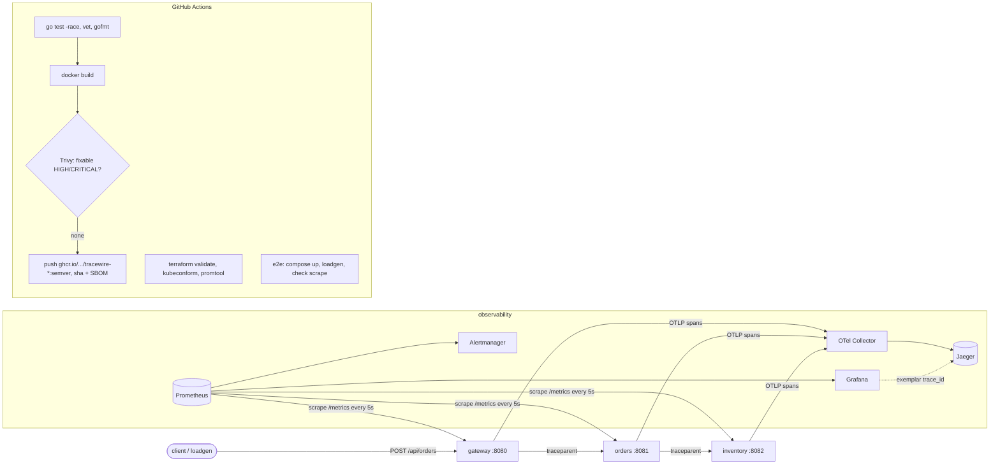

# tracewire

Three Go microservices with production-style platform tooling: OpenTelemetry tracing across services, Prometheus metrics with trace exemplars, SLO burn-rate alerts, a provisioned Grafana dashboard, a Trivy-gated CI/CD pipeline that pushes versioned images to GHCR, and Terraform that brings the whole thing up on a local Kubernetes cluster.

[](https://github.com/Ayaanahm/tracewire/actions/workflows/ci.yml)

## Architecture



**What each piece does**

| Component | Role |
|---|---|
| `gateway` | Public edge. Forwards `/api/orders` to orders; maps upstream failures to 502 |
| `orders` | Validates orders and reserves stock in inventory, inside a custom `orders.reserve_stock` span |
| `inventory` | Owns stock; atomic reservations (tested with 50 concurrent requests for 3 units: exactly 3 succeed) |
| `internal/telemetry` | One `Wrap()` per route: server span, latency histogram with `trace_id` exemplar, in-flight gauge |
| `internal/faults` | Latency/error injection via env or `PUT /admin/faults` to exercise dashboards and alerts on demand |
| `internal/httpx` | `/healthz`, `/readyz`, `/metrics`, JSON logs and graceful shutdown (readiness drain before close) |

## Console

The gateway serves a small console at http://localhost:8080. Start traffic, stall or fail a share of inventory's requests with the sliders, and see which hop the time goes to. A waterfall shows the slowest request of the last 10 seconds, with a link to its trace in Jaeger. It uses the `Server-Timing` header that orders and the gateway add to each response.


Fault sliders only work when the gateway runs with `CONSOLE_CONTROLS=true` (set in `docker-compose.yml`, off in Kubernetes).

## Demo

https://github.com/Ayaanahm/tracewire/raw/main/docs/img/demo.mp4

A 48-second walkthrough (recorded with `scripts/demo/scenes.js`, a Playwright script, so it can be re-recorded after UI changes). It breaks inventory from the console (25% of requests +320 ms, 4% errors), finds the cause three ways (console waterfall, Jaeger trace, Grafana), then restores it.

In Grafana, gateway p99 crosses the 250 ms SLO line and the error panel lights up in all three services as inventory's 503 propagates as a 502.


One request, one trace, three services. The custom span shows the time is spent waiting on inventory:


## Run it

**Docker Compose** (fastest: services, OTel Collector, Jaeger, Prometheus, Grafana):

```bash
make compose-up
curl -X POST localhost:8080/api/orders -d '{"sku":"sku-mouse","qty":1}'
go run ./cmd/loadgen -rps 100 -duration 5m     # generate traffic
open http://localhost:3000/d/tracewire-overview   # Grafana (anonymous viewer, admin/admin)
open http://localhost:16686                       # Jaeger

# break something on purpose
curl -X PUT localhost:8082/admin/faults -d '{"base_latency_ms":20,"slow_rate":0.15,"slow_latency_ms":320,"error_rate":0.03}'
```

**Kubernetes with Terraform** (kind cluster with 1 control plane and 2 workers, kube-prometheus-stack, OTel Collector, Jaeger, the services, PrometheusRule and dashboard):

```bash
make up      # builds images, kind load, terraform apply
#   gateway  -> http://localhost:8080/api/orders
#   grafana  -> http://localhost:3000  (admin / admin)
make down
```

Requires Docker, kind, kubectl and Terraform ≥ 1.6.

## CI/CD

`.github/workflows/ci.yml` runs on every push and PR:

1. **test**: `gofmt`, `go vet`, `go test -race` with coverage. The e2e tests start all three services in-process and check the full request path, error mapping, no overselling under concurrency, that **one trace ID spans all services**, and that `/metrics` exposes histograms with exemplars.
2. **infra**: `terraform fmt/validate`, `kubeconform` on the rendered Kustomize output, and `promtool check rules`.
3. **image** (matrix over the 3 services): build, **Trivy scan that fails on fixable HIGH/CRITICAL** (SARIF uploaded to GitHub code scanning), then push to `ghcr.io/<owner>/tracewire-<service>` tagged `1.2.3`, `1.2`, `sha-abc1234` and `latest`, with SBOM and provenance attestations.
4. **e2e**: `docker compose up`, a 20 s load test that must return 100% `201`, and a check that Prometheus is scraping all three services.

Release: `git tag v0.2.0 && git push --tags`.

## Results

| What | Measured |
|---|---|
| Trivy HIGH/CRITICAL in service images | **39 → 0** (all 39 were in the Go binary: 23 stdlib on Go 1.24, 16 in stale deps; distroless OS layer had none). Fixed by Go 1.27.3 and a dependency upgrade |
| Image size | 7.1 MB compressed (distroless static, non-root) |
| Prometheus p99 estimate vs exact (18k requests) | within **0.8–1.3%** with both default and tuned buckets. My tuned buckets did **not** improve accuracy: [write-up](docs/histogram-buckets.md) |
| Baseline latency at 150 req/s (local) | p50 35 ms, p95 69 ms, p99 184 ms, 17,933 requests, 100% `201` (simulated inventory work) |

## Technical decisions & trade-offs

Short version below; the full table is in [docs/technical-decisions.md](docs/technical-decisions.md).

- **Trivy is a hard gate, run from a pinned image** rather than a mutable action tag, because that job holds a registry push token.
- **distroless + non-root + read-only rootfs + `drop: [ALL]`**: the namespace enforces Pod Security `restricted`.
- **Graceful shutdown drains before closing**: readiness goes 503 on SIGTERM, then the server keeps serving for `SHUTDOWN_DRAIN_DELAY` so Kubernetes can remove the pod from endpoints before the listener closes.
- **Route patterns as labels** keep metric cardinality bounded; per-ID detail lives in traces.
- **Multi-window burn-rate alerts** (14.4× over 5 m and 1 h) instead of raw thresholds, so one bad minute doesn't page.
- **Exemplars** link a p99 spike on the dashboard to a slow trace in one click.
- **Terraform owns the cluster and monitoring stack.** For a real cluster I'd hand app manifests to GitOps (Argo CD/Flux).

## Known limitations

- Stores are in-memory and per-replica. With 2 replicas in Kubernetes, `GET /api/orders/{id}` can miss an order created on the other replica. A real version would use Postgres.
- `/admin/faults` is reachable inside the cluster (not through the gateway). It would need authentication or a NetworkPolicy outside a demo.
- No tail-based sampling yet, so rare errors can fall outside the 10% trace sample in Kubernetes.

## Layout

```
cmd/{gateway,orders,inventory,loadgen}   entrypoints
internal/{telemetry,faults,httpx}        shared platform code
internal/{gateway,orders,inventory}      service handlers
internal/e2e                             in-process integration tests
deploy/k8s                               Kustomize base + kind overlay
deploy/{prometheus,grafana,otel}         rules, dashboard, collector config
terraform/                               kind + kube-prometheus-stack + app
bench/                                   histogram accuracy benchmark + raw results
.github/workflows/ci.yml                 pipeline
```
